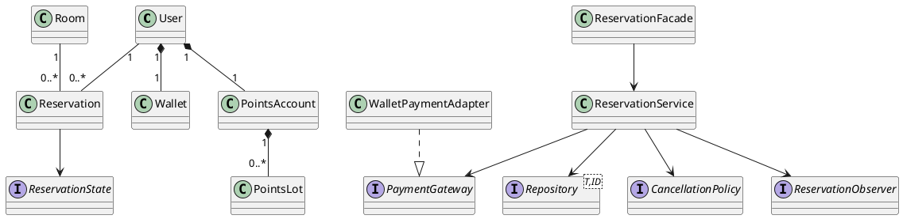

# Documento de análisis y diseño — HotelUQ

## Actores
- Cliente: consulta disponibilidad, reserva, paga, contrata servicios, cancela, consulta movimientos y redime puntos.
- Administrador: administra catálogo, clientes, reservas, promociones, servicios, recargas y reportes.

## Requisitos funcionales (trazabilidad)
RF-001 Registrar e iniciar sesión. RF-002 Consultar tipos, características y tarifas. RF-003 Consultar disponibilidad por fechas. RF-004 Crear reserva. RF-005 Agregar servicios. RF-006 Aplicar promoción válida. RF-007 Pagar con tarjeta virtual. RF-008 Consultar saldo y movimientos. RF-009 Cancelar reserva y reembolsar según política. RF-010 Consultar historial. RF-011 Consultar y redimir puntos. RF-012 Administrar habitaciones y tipos. RF-013 Administrar clientes y servicios. RF-014 Administrar promociones. RF-015 Recargar tarjetas (solo administrador). RF-016 Consultar estadísticas. RF-017 Exportar reportes TXT/PDF. RF-018 Consultar reportes gráficos.

## Reglas adicionales propuestas
RN-01 La capacidad máxima de la habitación no puede ser inferior al número de huéspedes solicitado (añadir campo huéspedes al formulario al ampliar el alcance). RN-02 Una habitación inactiva no puede reservarse. RN-03 Una reserva cancelada libera las fechas. RN-04 Las recargas y pagos deben ser positivos y quedar en el historial.

## Modelo del dominio y multiplicidades
- User 1 — 1 Wallet (cada cliente posee una tarjeta virtual).
- User 1 — 1 PointsAccount.
- User 1 — 0..* Reservation.
- Room 1 — 0..* Reservation a través del tiempo; cada Reservation referencia exactamente 1 Room.
- Reservation 1 — 0..* AdditionalService (servicios contratados).
- Wallet 1 — 0..* Movement.
- PointsAccount 1 — 0..* PointsLot.
- Reservation 1 — 1 estado actual (State).

## SOLID aplicado
- SRP: ReservationService valida y coordina reservas; ReportService genera reportes; PointsService administra puntos; Wallet administra saldo/movimientos.
- OCP: nuevas políticas de cancelación/promoción se agregan implementando CancellationPolicy o PromotionStrategy sin modificar el servicio consumidor.
- LSP: cualquier implementación de PaymentGateway puede sustituir a WalletPaymentAdapter respetando el contrato de pago.
- ISP: Repository, PaymentGateway, AdminOperations y ReservationObserver son interfaces pequeñas y enfocadas.
- DIP: ReservationService depende de Repository y PaymentGateway (abstracciones), no de implementaciones concretas.

## Patrones: problema, solución y clases
1. Factory Method — creación condicional de habitación; RoomFactory y RoomType.
2. Builder — reserva con varios datos opcionales; ReservationBuilder.
3. Singleton — configuración compartida; HotelConfig.
4. Facade — reserva requiere disponibilidad, servicios y pago; ReservationFacade.
5. Adapter — la billetera se integra a interfaz de pasarela; PaymentGateway y WalletPaymentAdapter.
6. Decorator — servicios acumulables sin crear subclases combinatorias; ServiceComponent, ServiceDecorator y BreakfastDecorator.
7. Proxy — recargas restringidas al administrador; AdminOperationsProxy.
8. Strategy — reglas intercambiables de reembolso y promociones; CancellationPolicy, StandardCancellationPolicy, HotelCancellationPolicy y PromotionStrategy.
9. Observer — avisar cambios de reserva; ReservationObserver y EmailNotificationObserver.
10. State — transiciones válidas; ReservationState, PendingState, ConfirmedState y CancelledState.

## Casos de uso principales
1. Reservar: cliente elige fechas y habitación → sistema valida fechas/disponibilidad/servicios → calcula total → verifica tarjeta → cobra → confirma → notifica.
2. Cancelar: sistema valida estado → aplica política temporal o cancelación por hotel → evita reembolso repetido → devuelve a tarjeta → notifica.
3. Recargar: administrador solicita recarga → Proxy valida rol → Wallet registra movimiento.
4. Redimir puntos: sistema descarta lotes vencidos → ordena por vencimiento → consume primero los próximos a vencer.
5. Reportar: administrador elige rango → ReportService filtra → calcula totales → exporta TXT.

## Diagrama de clases (PlantUML)

## Limitaciones y siguientes incrementos
La entrega es una base académica ejecutable con almacenamiento en memoria. Para completar un despliegue comercial se requiere base de datos, autenticación con contraseñas hasheadas, control transaccional de concurrencia, integración real de pagos, PDF, dashboard JavaFX de gráficos y CRUD completo de administración. La interfaz inicial demuestra reserva, cobro y consulta; los servicios de dominio contienen los puntos de extensión para implementar el resto sin mezclar capas.
